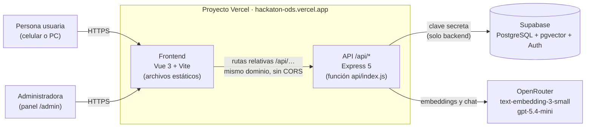

# Rimay

**Una voz segura para quien vive violencia en Villa El Salvador: reporta sin dar tu nombre, recibe orientación inmediata y, si lo pides, una persona te contacta de forma segura.**

- **Web pública:** https://hackaton-ods.vercel.app
- **Panel de aliados:** https://hackaton-ods.vercel.app/admin
- **Cuenta de demostración del panel:** `admin@rimay.pe` / `rimay2026`

Proyecto para el **HackODS UA 2026**. Todos los datos de la demo son ficticios.

---

## Equipo

**MJM Group**

- Carlos Javier Majerhua Nuñez
- Jhair Nina Meza
- Marcos Lazo Rodriguez

---

## El problema

En 2025 se registraron **3 079 denuncias por violencia contra la mujer e integrantes del grupo familiar en Villa El Salvador** (fuente: Observatorio Nacional de Seguridad Ciudadana, citado en el Reporte N.º 001-2026 de la MCLCP Lima Metropolitana). Y esas son solo las que llegaron a denunciarse.

Muchas personas que viven violencia no piden ayuda porque:

- **no saben a quién acudir** ni qué dice la ley;
- **tienen miedo** de que el agresor se entere, sobre todo si comparten el celular;
- sienten que primero tienen que **dar su nombre o su DNI**, o ir a una comisaría;
- la información no siempre está **en su idioma** (quechua o aimara) ni en un lenguaje sencillo.

---

## La solución

**Rimay** significa **«hablar»** en quechua. Es una plataforma web, pensada primero para el celular, con tres partes:

1. **Reporte seguro.** En tres pasos, anónimo por defecto, sin campos obligatorios y sin pedir DNI. Si la persona quiere, deja un medio y un horario seguros para que la contacten.
2. **Asistente con IA.** Responde dudas al instante con fuentes oficiales (Ley N.º 30364, Línea 100, CEM, cómo denunciar, plan de seguridad) y escucha con un enfoque de primera respuesta. Ante una señal de riesgo, muestra de inmediato el 105 y la Línea 100.
3. **Seguimiento humano.** Un panel para la institución aliada: los casos con riesgo aparecen primero, el contacto está protegido y cada acción queda registrada en el historial, hasta la derivación al CEM, a la Policía o a otra entidad.

---

## ODS abordado

**ODS 5: Igualdad de género**, meta **5.2**: eliminar todas las formas de violencia contra todas las mujeres y las niñas en los ámbitos público y privado.

---

## Funcionalidades principales

### Web pública

- **Inicio «¿Qué necesitas ahora?»:** estoy en peligro (llamar al 105), quiero contar lo que pasa (reporte), tengo dudas (asistente) y quiero ayudar a alguien (guía).
- **Reporte en 3 pasos:** 1) tu seguridad, 2) lo que pasó, 3) qué apoyo necesitas. La confirmación muestra un código de referencia y los próximos pasos según el apoyo elegido.
- **Páginas informativas:** Cómo funciona, Infórmate (señales, tipos de violencia, derechos, plan de seguridad, cómo ayudar y directorio), Preguntas frecuentes y Nosotros.
- **Accesibilidad:** diseño adaptado al celular (textos de 15 a 16 px y áreas táctiles de 40 a 44 px), campos que no hacen zoom en el iPhone, tamaño de texto Normal/Grande y modo oscuro automático.

**Medidas para la seguridad de la víctima**

- **«Salir rápido»** siempre visible (también con el chat abierto). Con el botón o con **Esc tres veces** en menos de 1,2 s, oculta la página y la reemplaza por Google en el historial, sin pantallas intermedias.
- **Modo anónimo por defecto.** Ningún campo es obligatorio y nunca se pide el DNI. Si se desactiva el anonimato: nombre o seudónimo, medio seguro (mensaje de texto, WhatsApp o llamada), número, horario seguro y **dirección opcional**.
- **Nada del reporte se guarda en el navegador:** el borrador vive solo en memoria hasta pulsar «Enviar reporte».
- **Avisos del paso 1**, que nunca bloquean continuar:

  | Pregunta | Respuesta | Aviso |
  | --- | --- | --- |
  | ¿Es seguro usar este dispositivo ahora? | No / No estoy seguro/a | Usar la Línea 100 o el Chat 100 desde otro dispositivo, con botón «Salir ahora» |
  | ¿Existe peligro inmediato? | Sí | Botones para llamar al 105 y a la Línea 100 |
  | ¿Existe peligro inmediato? | No sé | La Línea 100 puede evaluar la situación: llamar, Chat 100 o asistente |

- **Enlaces directos** al **105**, la **Línea 100** y el **Chat 100** en la franja superior, en los avisos y en el asistente. Cada uno tiene un **tooltip** que indica a qué entidad pertenece: 105, Policía Nacional del Perú; Línea 100 y Chat 100, Ministerio de la Mujer (MIMP); 106, SAMU; 113 opción 5, salud mental del Minsa.
- **Idiomas: español, quechua y aimara.** Selector en el inicio y en el menú. Las traducciones son **preliminares** (la web lo indica) y, si falta alguna, se muestra el español.
- Título de pestaña neutro («Consultas») y favicon neutro.

### Asistente

- Botón flotante «¿Necesitas orientación?». En celular, el chat ocupa toda la pantalla debajo de la barra de «Salir rápido».
- Distingue la intención del mensaje:
  - **saludo, agradecimiento, despedida o «¿quién eres?»:** respuesta cálida y breve, sin buscar en la base;
  - **relato o desahogo** («mi pareja me grita»): valida, escucha y pregunta qué necesita la persona;
  - **pregunta informativa:** responde con la base de conocimiento y muestra la **fuente**;
  - **fuera de tema:** explica qué puede hacer y ofrece opciones.
- Entiende preguntas de seguimiento («¿y qué puedo hacer?») con los últimos 6 mensajes, que viven solo en la memoria de la página.
- Propone **sugerencias** para seguir la conversación, convierte los números y enlaces en botones para tocar (`tel:`) y tiene una barra fija «¿Hablar con una persona? Línea 100 | Chat 100».
- **Tarjetas de ayuda inmediata:** ante una señal de riesgo de violencia, el 105 y la Línea 100; ante una crisis emocional («quiero morir»), además la **Línea 113, opción 5** (salud mental del Minsa).
- Las respuestas del asistente están en español.

### Panel `/admin`

- **Inicio de sesión** con la cuenta de demostración. Hay un solo rol, administradora.
- **Bandeja de casos:**
  - incluye los reportes con contacto y los anónimos (estos, sin datos de contacto);
  - los casos con riesgo pendientes aparecen primero;
  - alerta roja si un caso con riesgo lleva más de 1 hora sin contacto;
  - filtros: Todos, Con riesgo, Pendientes, Contactados, Derivados y Cerrados;
  - cada tarjeta indica «Contacto: …» o «Derivado a: …»;
  - se refresca cada 30 segundos.
- **Detalle del caso:**
  - teléfono enmascarado (`••• ••• 821`) y dirección oculta hasta pulsar «Mostrar»; cada acceso queda registrado;
  - primer mensaje neutro sugerido, que no menciona el motivo;
  - **Análisis de apoyo** con IA;
  - seguimiento: estado (Pendiente, Contactado, Derivado o Cerrado), «¿Quién la contacta?» y derivación (Policía, CEM u otra entidad con su nombre). Cada cambio guarda un solo evento en el historial;
  - notas internas e historial completo.
- **Dashboard** con datos reales de la base:
  - indicadores: casos activos, casos con riesgo activos, promedio de horas hasta el primer contacto y casos derivados;
  - gráficos: tipos de violencia, reportes de los últimos 7 días, casos por estado y derivaciones (CEM, Policía y otras entidades).
- **Base de conocimiento:**
  - lista de documentos;
  - subida de archivos `.md` o `.txt` de hasta 4 MB, que se dividen en fragmentos, se convierten en embeddings y pasan a «Procesado»;
  - «Probar búsqueda» para ver qué fragmentos recupera el asistente.

---

## Uso responsable de la IA

**Lo que hace la IA**

- **Asistente con RAG (generación aumentada por recuperación):** busca en la base de conocimiento los fragmentos más parecidos a la pregunta (pgvector) y el modelo responde **solo con ese contexto**. Si el contexto no tiene el dato, responde «No tengo ese dato exacto» y ofrece alternativas en lugar de inventar.
- **Análisis de apoyo en el panel**, a pedido de la administradora: resume el caso, señala qué requiere atención y sugiere opciones con la guía de Rimay. Es **orientativo: la decisión siempre es humana**.

**Lo que no hace**

- **No diagnostica** ni hace evaluaciones clínicas, y **no califica el riesgo** con puntajes: solo explica con cuidado («eso puede corresponder a violencia psicológica»).
- **No recibe datos de contacto:** el análisis de apoyo no envía al modelo el alias, el teléfono ni la dirección.
- **No guarda conversaciones:** el chat no se almacena en el servidor ni en el navegador, y no se registra el texto de las preguntas en los logs. El análisis de apoyo tampoco se guarda.
- **No pide datos personales** ni que la persona repita su relato.

**La detección de riesgo no depende de la IA.** Funciona con reglas sobre el mensaje («me va a golpear», «tengo miedo», «quiero morir»…) **antes** de llamar al modelo, así que la tarjeta con el 105 y la Línea 100 aparece al instante, aunque el servicio de IA esté lento o caído.

> La demo usa solo datos ficticios. Antes de usar datos reales falta ocultar teléfonos, DNI y direcciones dentro del relato antes de enviarlo al modelo, y usar proveedores de IA que no guarden la información (ver [Limitaciones y próximos pasos](#limitaciones-y-próximos-pasos)).

---

## Arquitectura



Un solo repositorio y un solo `package.json`. Vercel sirve el frontend como archivos estáticos y ejecuta la API Express como una función (`api/index.js` reutiliza `server/app.js`). **El navegador nunca habla con Supabase ni con OpenRouter:** todo pasa por `/api/...`, y las claves viven solo en el backend.

**Monolito modular.** El backend está en `server/modules/`. Cada módulo tiene sus rutas y su servicio, solo exporta su router y no importa servicios de otros módulos:

| Módulo | Qué hace |
| --- | --- |
| `reports` | Recibe los reportes (`POST /api/reports`) y guarda reporte, contacto, evento y consentimientos |
| `rag` | Asistente: detección de riesgo, intención, búsqueda en la base y respuesta (`POST /api/rag/chat`) |
| `auth` | Inicio de sesión con Supabase Auth y datos del personal |
| `cases` | Bandeja, detalle, acceso al contacto, seguimiento, notas y análisis de apoyo |
| `stats` | Indicadores y gráficos del dashboard |
| `kb` | Base de conocimiento: listar, subir (fragmentos y embeddings) y probar búsqueda |

Lo compartido está en `server/common/`: configuración, cliente de Supabase, guard de autenticación, manejo de errores y el **proveedor de IA común** (`ai.js`). Ese módulo elige OpenRouter, OpenAI o Gemini según `AI_PROVIDER`.

---

## Tecnologías utilizadas

| Capa | Tecnología |
| --- | --- |
| Frontend | Vue 3 (Composition API, `<script setup>`), Vue Router, Vite, CSS propio (sin librerías de UI), íconos de línea `lucide-vue-next` |
| Backend | Node.js 22+, Express 5 (monolito modular), Multer para la subida de archivos |
| Base de datos y autenticación | Supabase: PostgreSQL, pgvector (búsqueda por similitud, índice HNSW), Supabase Auth; 12 migraciones en `supabase/migrations/` |
| IA | OpenRouter con el SDK oficial `openai`: `openai/gpt-5.4-mini` (chat, razonamiento mínimo) y `openai/text-embedding-3-small` (768 dimensiones). OpenAI directo y Gemini como alternativas |
| Despliegue | Vercel (preset Vite + una función para la API, región `pdx1`), despliegue automático desde `main` |
| Calidad | `npm run check` (valida claves y servicios) y `npm run smoke` (prueba de humo del flujo completo) |
| Idiomas | `public/textos.json` (español, quechua y aimara) con un composable propio `useI18n` |

---

## Fuentes oficiales de la base de conocimiento

Los documentos están en [`knowledge/`](knowledge/) y se cargan con `npm run kb:seed`:

| Documento | Fuente |
| --- | --- |
| Ley N.º 30364: tipos de violencia y derechos | Ley N.º 30364 (resumen en lenguaje sencillo) |
| Línea 100 y Chat 100 | Ministerio de la Mujer y Poblaciones Vulnerables (MIMP) |
| Centro de Emergencia Mujer (CEM) | Guía Rimay, con información del MIMP |
| Cómo presentar una denuncia | Guía Rimay, basada en la Ley N.º 30364 |
| Directorio de ayuda | Canales oficiales: MIMP, Policía Nacional (105), SAMU (106) |
| Plan de seguridad | Guía Rimay |
| Cómo ayudar a alguien que vive violencia | Guía Rimay |

La **Línea 113, opción 5** (salud mental del Minsa), que aparece en la tarjeta de crisis emocional, se verificó en [gob.pe/555](https://www.gob.pe/555). Rimay no muestra números, direcciones ni horarios que no estén en estas fuentes.

---

## Instalación y uso en local

**Requisitos:** Node.js 22 o superior, un proyecto de [Supabase](https://supabase.com) y una clave de [OpenRouter](https://openrouter.ai) con créditos (o de OpenAI o Gemini).

1. **Instalar dependencias y crear el `.env`:**
   ```bash
   npm install
   cp .env.example .env
   ```
2. **Completar las variables de entorno** en `.env`. Aquí solo van los nombres; `.env.example` trae los valores por defecto de los modelos.

   | Variable | Para qué sirve |
   | --- | --- |
   | `SUPABASE_URL` | URL del proyecto de Supabase |
   | `SUPABASE_SERVICE_ROLE_KEY` | Clave secreta de Supabase (solo backend) |
   | `SUPABASE_ANON_KEY` | Opcional: clave pública para el inicio de sesión |
   | `AI_PROVIDER` | Proveedor de IA: `openrouter`, `openai` o `gemini` |
   | `OPENROUTER_API_KEY`, `OPENROUTER_BASE_URL`, `OPENROUTER_EMBEDDING_MODEL`, `OPENROUTER_CHAT_MODEL` | Proveedor OpenRouter |
   | `OPENAI_API_KEY`, `OPENAI_EMBEDDING_MODEL`, `OPENAI_CHAT_MODEL` | Alternativa: OpenAI |
   | `GEMINI_API_KEY`, `GEMINI_EMBEDDING_MODEL`, `GEMINI_CHAT_MODEL` | Alternativa: Gemini |
   | `AI_REASONING_EFFORT`, `AI_MIN_SIMILARITY`, `APP_URL` | Opcionales: ajustes del modelo y del umbral de búsqueda |
   | `PORT` | Solo local (por defecto, 3000) |

   Solo son obligatorias las de Supabase y las del proveedor de IA elegido.
3. **Validar la configuración.** Comprueba las variables, los embeddings, el chat y Supabase sin mostrar las claves. Todo debe salir en ✓:
   ```bash
   npm run check
   ```
4. **Aplicar las migraciones en Supabase:**
   ```bash
   npx supabase login
   npx supabase link --project-ref <REF_DEL_PROYECTO>
   npx supabase db push
   ```
5. **Cargar los datos de demostración:** la cuenta `admin@rimay.pe`, 6 casos con contacto y 20 reportes anónimos, todos ficticios.
   ```bash
   npm run seed
   ```
6. **Cargar la base de conocimiento** del asistente desde `knowledge/`:
   ```bash
   npm run kb:seed
   ```
   Si cambias de proveedor de IA o de modelo de embeddings, vuelve a ejecutarlo: los embeddings no son compatibles entre proveedores.
7. **Levantar la app:** Vite en http://localhost:5173 y Express en el puerto 3000, con proxy de `/api`.
   ```bash
   npm run dev
   ```
   La web pública está en http://localhost:5173 y el panel en http://localhost:5173/admin.
8. **Prueba de humo**, en otra terminal. Recorre reporte, asistente, inicio de sesión, seguimiento, dashboard y base de conocimiento, y borra lo que crea:
   ```bash
   npm run smoke
   ```

Otros comandos: `npm run build` (genera `dist/`), `npm run kb:test -- "pregunta"` (prueba la búsqueda), `npm run i18n:pendientes` y `npm run i18n:importar` (flujo de traducciones; ver [`docs/traducciones/`](docs/traducciones/)).

---

## Despliegue

El repositorio está conectado a Vercel: **cada push a `main` se despliega automáticamente** en https://hackaton-ods.vercel.app. Como va directo a producción, antes de cada push se corre la prueba de humo en local:

```bash
npm run dev            # en una terminal
npm run smoke          # en otra: debe terminar con «✓ Flujo feliz completo.»
git push origin main   # solo si la prueba de humo pasó
```

Cuando termina el despliegue, se repite la prueba contra producción:

```bash
npm run smoke -- https://hackaton-ods.vercel.app
```

**Variables que hay que cargar en Vercel** (Project → Settings → Environment Variables, entorno Production): `SUPABASE_URL`, `SUPABASE_SERVICE_ROLE_KEY`, `AI_PROVIDER`, `OPENROUTER_API_KEY`, `OPENROUTER_BASE_URL`, `OPENROUTER_EMBEDDING_MODEL` y `OPENROUTER_CHAT_MODEL`. Para las vistas previas de otras ramas, marca también el entorno Preview.

Las migraciones, el seed y la base de conocimiento se aplican desde la máquina del equipo, contra el mismo proyecto de Supabase que usa producción (pasos 4 a 6 de la instalación).

La configuración está en [`vercel.json`](vercel.json):
- preset Vite y región `pdx1`;
- `maxDuration` de 300 s para la función;
- `/api/*` va a Express y el resto a `index.html`, para que Vue Router resuelva las rutas.

---

## Guion de la demo (2 a 3 minutos)

1. **María entra a Rimay desde su celular.** Pulsa «Reportar un caso». En el paso 1 marca «Sí» en peligro inmediato y aparece el aviso rojo con los botones para llamar al 105 y a la Línea 100. Ninguno la obliga a nada, así que continúa.
2. **Paso 2:** desactiva «Enviar de forma anónima», escribe un seudónimo, elige «Mensaje de texto», su número y el horario seguro «de 9 a 11 a. m.». La dirección la deja en blanco, porque es opcional.
3. **Paso 3:** elige apoyo legal y psicológico y envía. Recibe un código de referencia y los próximos pasos: «Te contactaremos. Una persona del equipo de apoyo te escribirá por mensaje de texto en el horario que indicaste…».
4. **Abre el asistente** y pregunta «¿Necesito un abogado para denunciar?». Recibe una respuesta clara con la fuente «Cómo presentar una denuncia» y sugerencias para seguir. Si escribe «tengo miedo, me va a golpear», aparece al instante la tarjeta con el 105 y la Línea 100.
5. **Una administradora entra a `/admin`** con `admin@rimay.pe`. El caso de María aparece primero, marcado con riesgo.
6. **Abre el caso:** pulsa «Mostrar» para ver el teléfono (queda registrado), revisa el primer mensaje neutro sugerido y genera el **análisis de apoyo**.
7. **Registra el seguimiento:** pasa el caso a «Contactado» indicando quién la contacta y luego a «Derivado» al CEM. El historial y el dashboard se actualizan.
8. **Cierre:** vuelve a la web pública, cambia el idioma a quechua o aimara y pulsa **«Salir rápido»**: la página se reemplaza por Google al instante.

---

## Limitaciones y próximos pasos

- **Traducciones por validar.** Las versiones en quechua y aimara son preliminares y deben revisarlas hablantes nativos, en especial los mensajes de emergencia. Las respuestas del asistente todavía están solo en español.
- **Convenios con instituciones aliadas.** Definir qué institución (CEM, Municipalidad de Villa El Salvador u organizaciones locales) operaría el panel y con qué protocolo de contacto.
- **Permisos por rol.** Hoy hay un solo rol, administradora, que hace todo. Para producción: roles diferenciados (por ejemplo, coordinación y gestión de casos) y acceso a los datos de contacto según el rol.
- **Validación profesional.** Los contenidos de la base de conocimiento, las respuestas del asistente y el análisis de apoyo deben revisarlos profesionales de psicología, derecho y trabajo social.
- **Privacidad antes de usar datos reales.** Ocultar teléfonos, DNI, correos y direcciones dentro del relato antes de enviarlo a la IA, usar proveedores que no guarden la información y revisar el cumplimiento de la Ley N.º 29733 de protección de datos personales.
- **Otras mejoras:** subida de PDF a la base de conocimiento.
